# Omnipath

An original 2D pixel-art action RPG made for the iPad and phones (it also plays in any desktop browser). You never
pick skills from a menu: you **discover** them by fighting, exploring and helping the people of the vale.

- **Master** a skill by using it: its stars fill up as you fight.
- **Transform** a skill at full rank into a new one, and keep the old one too. Slash becomes Whirlwind or Sword Throw.
- **Find elements** by doing things: forging, fishing, mining, meditating, hunting a warden.
- **Fuse** skills and elements at the altar. Fire + Whirlwind makes **Flame Spin**; Flame Spin + Tornado makes
  **Firestorm**.
- **Become a class.** A class is a weapon plus a way of fighting, and it finds you: fight with one weapon long enough
  and its first class unlocks; bring an element to it and rarer ones follow. Each class has five skills of its own,
  one thing only it can do (Heat, a Hearth, a turning tide, a pinned shadow…) and its own outfit. There are 26.
- **Hold a weapon, or none.** Sword, Dagger, Rod and **Bare Hands** each have their own skills. A weapon's skills need
  that weapon in your hand; spells and body moves work with anything.
- **Help everyone.** Every NPC has quests, and trainers teach their skills only as quest rewards.

Everything you see and hear (tiles, characters, monsters, icons, effects, sounds) is generated in code when the game
starts. The game ships no image or audio files.

| | iPad (1180×820) | Phone (390×844) |
|---|---|---|
| **Hearthvale**, the starting town | 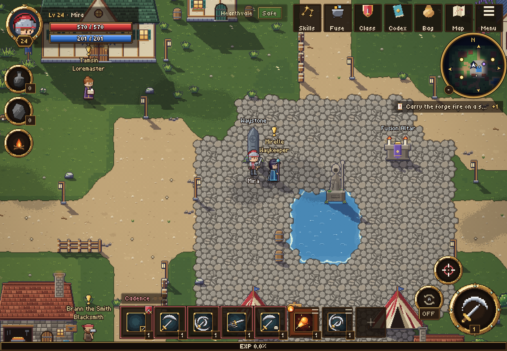 | 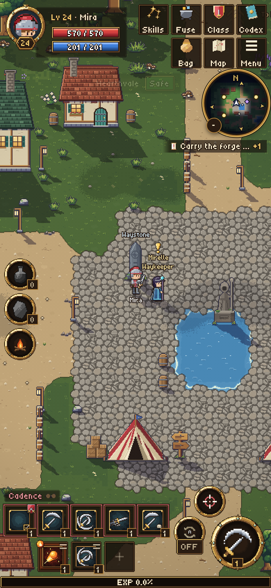 |
| **Mirror Lake** | 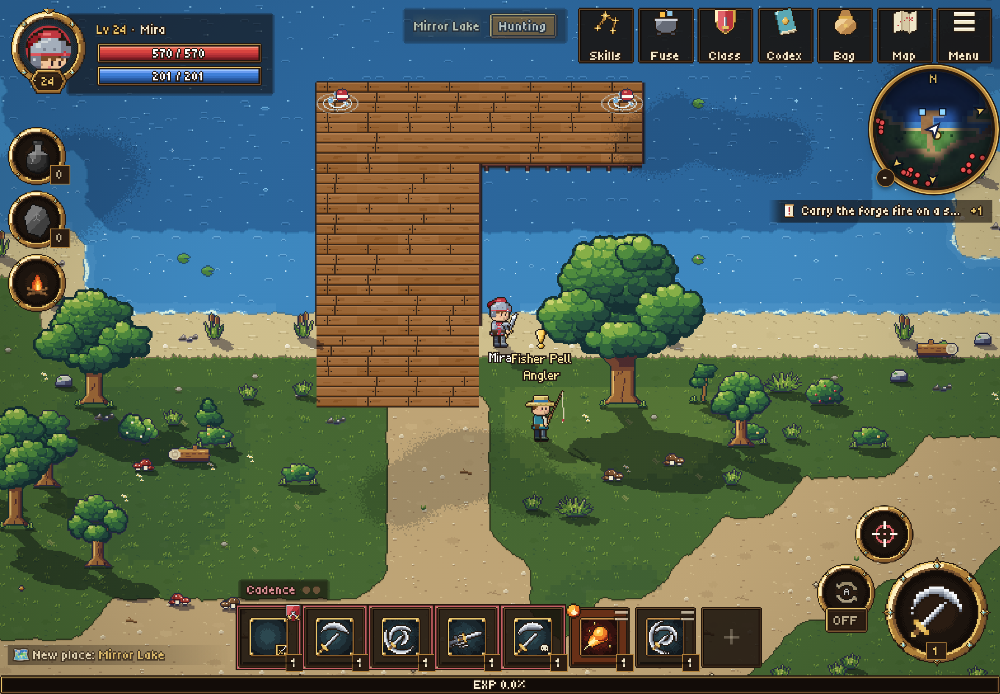 | 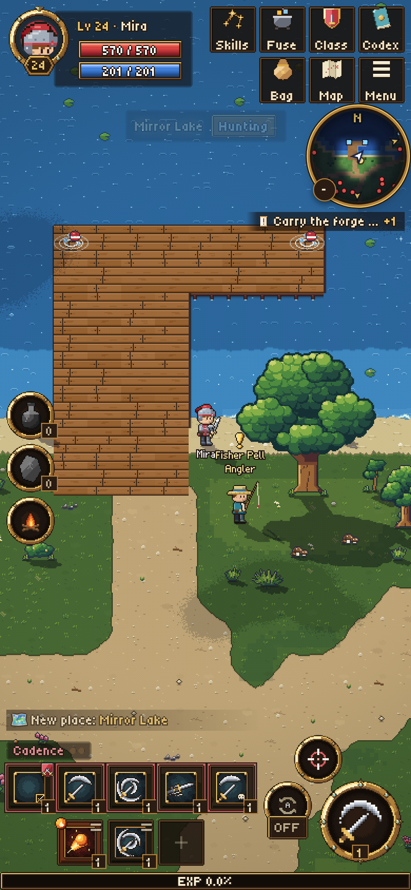 |
| **Gloomwood** | 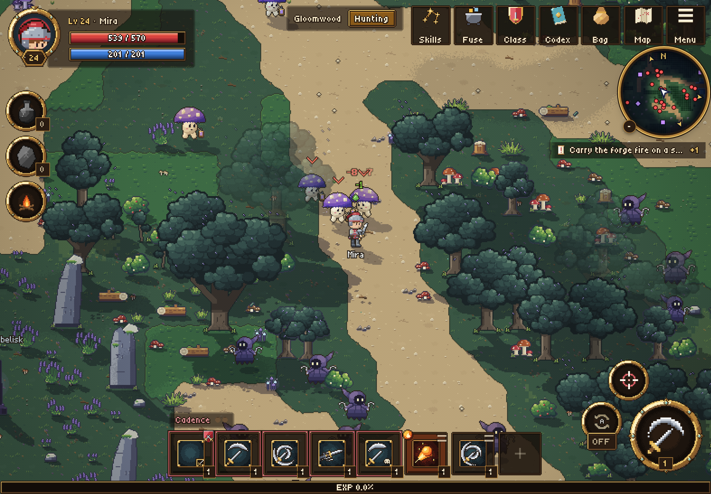 | 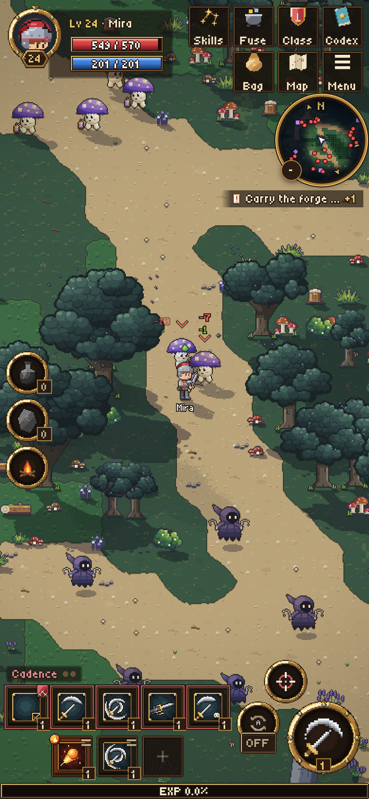 |
| **Hollow Barrow**, a dungeon | 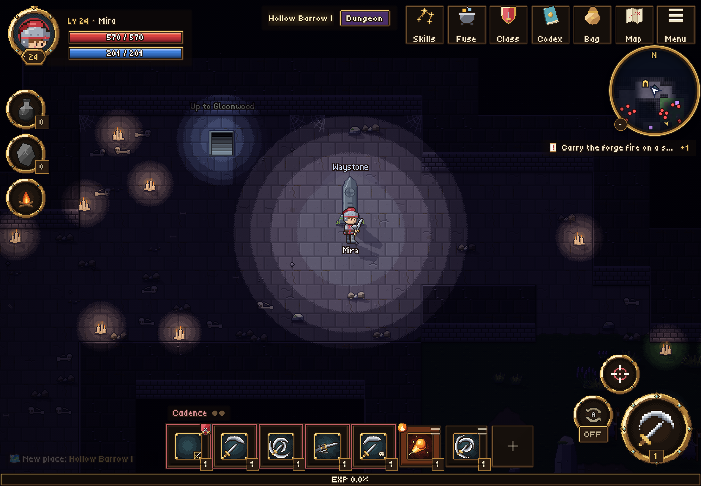 | 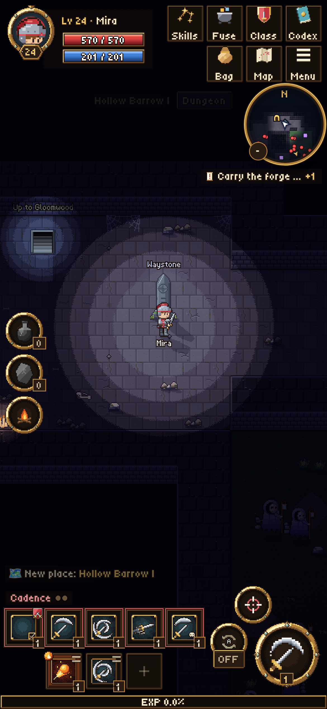 |
| **Stormbreak**, Thunderhoof's arena | 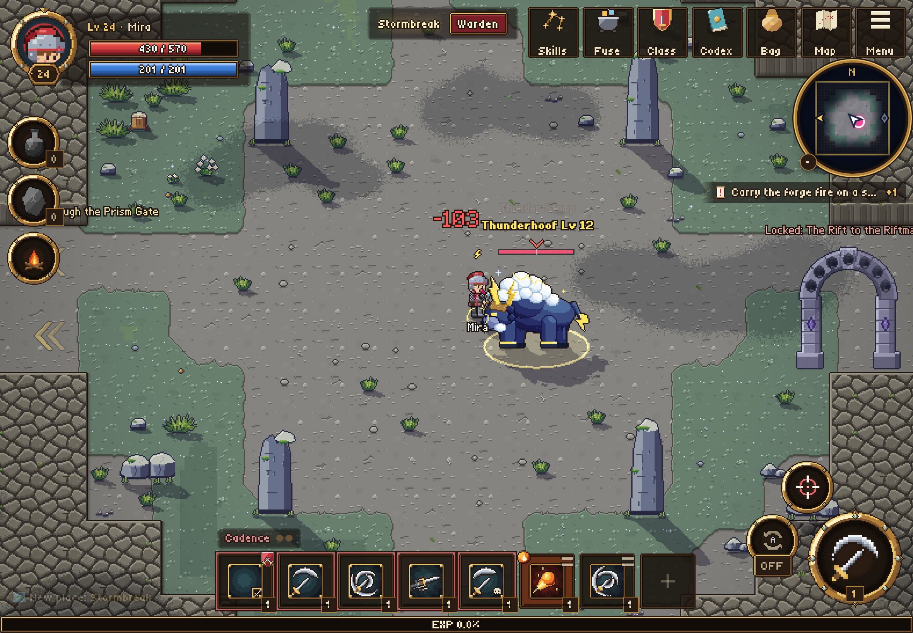 | 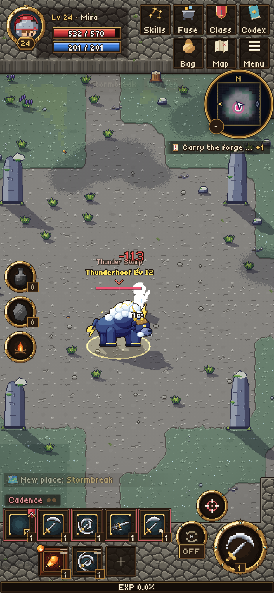 |
| **Riftmarch**, beyond the Rift | 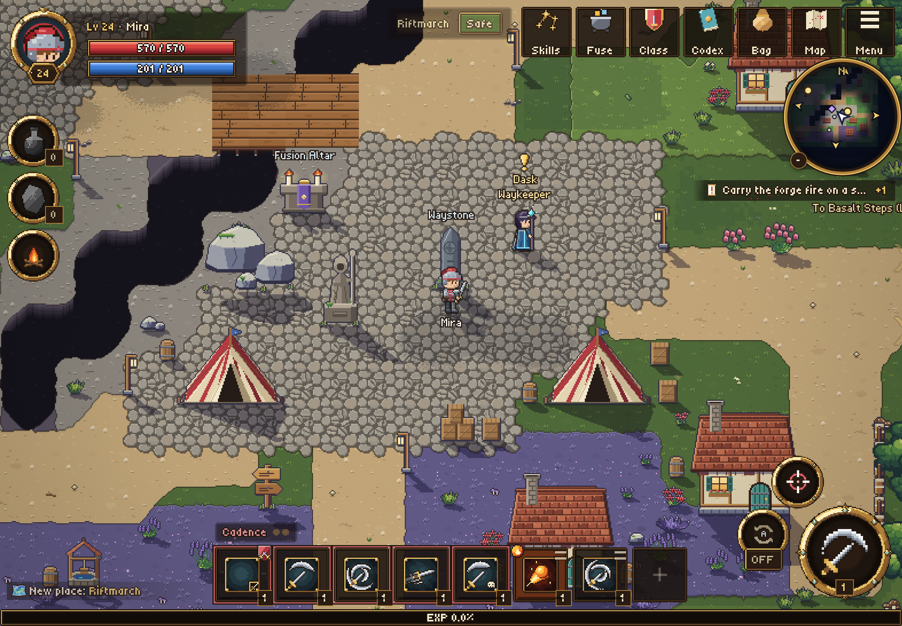 | 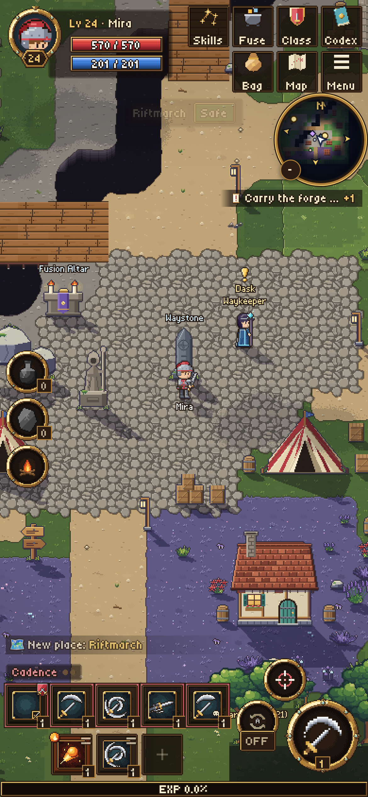 |

## Play it on an iPad or phone

**Same Wi-Fi as your computer**

```bash
npm install
npm run dev          # prints a Network: URL such as http://192.168.1.20:5173
```

Open the `Network:` URL in Safari on the iPad. For fullscreen, use Share → **Add to Home Screen** and start the
game from its icon.

**One file you can host anywhere**

```bash
npm run build:single # writes dist-single/omnipath.html (about 1.7 MB)
```

The game, its CSS and its two pixel fonts are inside that one HTML file; only Phaser loads from the jsDelivr CDN.
Put the file on any static host (Netlify Drop, GitHub Pages, …) and open the URL on the device.

The game saves by itself (in the browser's `localStorage`). To start over: **☰ Menu → New game**.

## How to play

| Do this | How |
|---|---|
| **Move** | Tap the ground. There is no joystick: you walk to wherever you tap. |
| **Talk, gather, travel** | Tap an NPC, an ore vein, a fishing spot, a shrine or a portal. You walk there and use it. |
| **Attack** | Tap the big **⚔** button for one swing. Hold it to keep swinging. Tapping a monster picks it as your target and walks you to it. **Target** picks the next closest monster. |
| **Use a skill** | Tap its slot in the bar at the bottom. With two thumbs you can tap two slots at once. |
| **AUTO** | One on/off switch next to ⚔. When it is on, you fight by yourself: the basic attack and every skill on your bar. When it is off, nothing happens unless you tap. Your own taps always win. |
| **Heal, Recall, Rest** | The round buttons on the left. Rest makes you recover much faster until you move. |

### The skill bar: class slots and your slots

The bar has **8 slots**. The **5 on the left are class slots**: they carry your class's emblem and the class fills
them by itself with related skills. The **3 on the right are your slots**: hold one (or tap an empty one) to pick any
skill you like from a grid of icons. Hold a class slot to see that skill's card. With no class, all 8 slots are yours.

**Weapons matter.** Sword, dagger, rod and bare-hand skills need that weapon in your hand. With another one, the
slot goes dim and shows the weapon it needs ("Needs a sword — Equip"): tap it once to swap. Spells such as Ember Dart
and body moves such as Rising Kick work with any weapon. **Bare Hands** is a weapon too (Bag → put your weapon away),
with its own tree that starts at Jab. Changing weapons takes a moment in a fight.

### Classes equip themselves

- A class unlocks by what you do: land 60 hits with a sword and you are a **Blademaster**; with bare hands, a
  **Wayfarer**; defeat 20 foes with fire while holding a sword and **Pyroblade** finds you. You get one card.
- Your first class is put on for you. Later, open **Class** and tap **Become** on any unlocked class (not in the
  middle of a fight). Becoming a class also equips its weapon.
- The 5 class slots hold the class's **own five skills**. Two come at once, the others at Class Levels 2, 4 and 6; a
  slot whose skill you do not have yet borrows another skill you know.
- A class levels up only while you wear it (to Class Level 10: **Mastered**). Its rarity (Common … Epic) says how
  hard it is to find, never how strong it is.
- Each class has **one widget above the bar** for the one thing only it does. Eight classes are fully rebuilt so far:

  | Class | Weapon | What only it does |
  |---|---|---|
  | Blademaster | Sword | **Cadence**: three different sword skills, the third always crits |
  | Knife Juggler | Dagger | **Juggle**: every thrown knife that hits makes the next one faster |
  | Spellwright | Rod | **Weave**: three different spells, the fourth is free and bigger |
  | Wayfarer | Bare Hands | **Road Rhythm**: Jab, Jab, then a class skill lands a Roadhouse hit |
  | Pyroblade | Sword + Fire | **Heat**: sword hits build it; full, the next class skill is huge and costs HP |
  | Shadowstalker | Dagger + Shadow | **Pinned Shadow**: pin a foe, half your damage lands again when the pin ends |
  | Pyromancer | Rod + Fire | **Hearth**: a fire you place; kills beside it make it grow, then you throw it |
  | Tidereader | Rod + Water | **High Tide / Low Tide**: the tide turns by itself and changes your spells |

  The other 18 classes already have their own five skills and a simple three-skill rhythm; their full rebuilds come
  in later phases (docs/SPEC-v4.md §15).

### The Star Chart (Skills button)

Every skill is a star in a night sky: the sword, dagger, rod and bare-hands constellations, the elements at the centre, and the
techniques, wild echoes and class signatures around them. Drag to look around, pinch to zoom, tap a star to see its
card. A card always has **one** button: **Equip**, **Transform** when the skill is ready, or the next step ("Reach rank
10 to transform."). Unknown stars show a **?** only when they are one step away from something you know.

### Quests

Every NPC has quests. The marks above their heads mean: gold **!** a new quest, gold **?** ready to turn in, grey
**…** in progress. Talk to them to accept, check and complete. Your quests and the next discoveries show in the
**Pursuits** list on the right (tap one to open it); the **Codex → Quests** tab has all of them. Trainers teach their
techniques only as quest rewards.

### Growing stronger

- **Mastery:** using a skill ranks it up (★). At full rank it can **Transform** (✨) into a new skill.
- **Elements:** forge with Brann in Hearthvale (Fire), fish at Mirror Lake (Water), mine at Greystone Quarry (Earth),
  meditate at the Shrine of Winds (Wind), clear the guardians of the obelisk in Gloomwood (Shadow), beat Thunderhoof at Stormbreak
  (Lightning), and visit Sister Alba once you carry three (Holy). Fusing elements makes Ice, Magma, Storm and Twilight.
- **Fuse:** the **Fuse** button appears after your first element. Combine skills and elements at the altar; failed
  tries whisper hints.

### Menu (☰)

Sound on/off and volume, **Reduce shake & flashes** (calmer screen shake, no screen flashes), and New game.

### Keyboard and mouse (desktop)

| Key | Does |
|---|---|
| Click | Move / talk / pick a target |
| `1`–`8` | Use the skill in that slot |
| `Space` | Attack (hold to keep swinging) |
| `A` | AUTO on/off |
| `M` | Show or hide the minimap |

## Build, test and check

```bash
npm install
npm run dev            # dev server with hot reload, open on your LAN
npm test               # Vitest: rules, content integrity, world, quests, HUD layout, star chart, VFX, audio
npm run typecheck      # tsc --noEmit
npm run build          # typecheck + production build into dist/
npm run preview        # serve dist/ (add --port 4173)
npm run build:single   # one self-contained HTML file in dist-single/
```

Browser playtest (Playwright; it starts a new game, opens every panel, becomes a class, plays a quest, fights, walks
through portals and warps through all 28 maps):

```bash
npm run build && npx vite preview --port 4173 --strictPort &
node scripts/playtest.mjs http://localhost:4173/ --device ipad              # 1180x820 @2
node scripts/playtest.mjs http://localhost:4173/ --device phone             # 390x844 @3
node scripts/playtest.mjs http://localhost:4173/ --device phone-landscape   # 844x390 @3
```

Add `--quick` for a shorter run and `--shots <dir>` to save screenshots. `node scripts/vfx-sheets.mjs` writes contact
sheets of every spell effect.

URL options: `?fast` speeds up mastery for testing; `?k=3` forces the pixel scale.

## Code map

```
src/core     the rules: mastery, transforms, fusion, weapons, classes and their mechanics, quests, combat, saves
             (no Phaser or DOM, so a server can run it)
src/data     all content: about 200 skills, 26 classes, 55 quests, 41 monsters, 11 elements, 28 maps
src/game     the Phaser client: procedural pixel art (art/), pixel-perfect rendering (render/), actors (entities/),
             combat and interactions (systems/), spell effects (vfx/), procedural sound (audio/), scenes
src/ui       the DOM overlay: HUD, skill bar and picker, Star Chart, panels (Class, Codex, Bag, Fuse, Map), dialogs
tests        Vitest suites
scripts      playtest, single-file build, VFX contact sheets
docs         design and build specs (start with docs/DESIGN.md; the design of record is docs/SPEC-v4.md)
```

### Adding a skill

1. Add a `SkillDef` to the right file in `src/data/skills/`.
2. Connect it: a transform (`src/data/morphs/`), a fusion recipe (`src/data/recipes/`), a class signature, a quest
   reward or an item.
3. Give it `weapons` if it needs one in hand, and a `delivery` / `extra` that no other skill of its kind shares.
4. Run `npm test`. It fails on broken references, duplicate recipes, skills that can't be reached, two skills that
   are the same in all but name (`distinct.test`), and a skill or Gift that promises an effect the game does not
   have (`skill-promises.test`).

Old saves load: a save from before the class rebuild keeps every skill, class and level (four old classes merged
into others; the rules are in docs/SPEC-v4.md §13).

## Ship to phones as an app

The game is a PWA. To build native apps, wrap `dist/` with [Capacitor](https://capacitorjs.com/):

```bash
npm i @capacitor/core @capacitor/cli @capacitor/android @capacitor/ios
npx cap init Omnipath com.example.omnipath --web-dir dist
npm run build && npx cap add android && npx cap add ios
npx cap sync && npx cap open android   # or: npx cap open ios
```

## Credits

All art and sound are original and generated in code. Fonts: Pixelify Sans and Tiny5 (SIL Open Font License, see
`public/licenses/`). Sound synthesis: ZzFX by Frank Force (MIT). Details in
[`THIRD-PARTY-NOTICES.md`](THIRD-PARTY-NOTICES.md).
