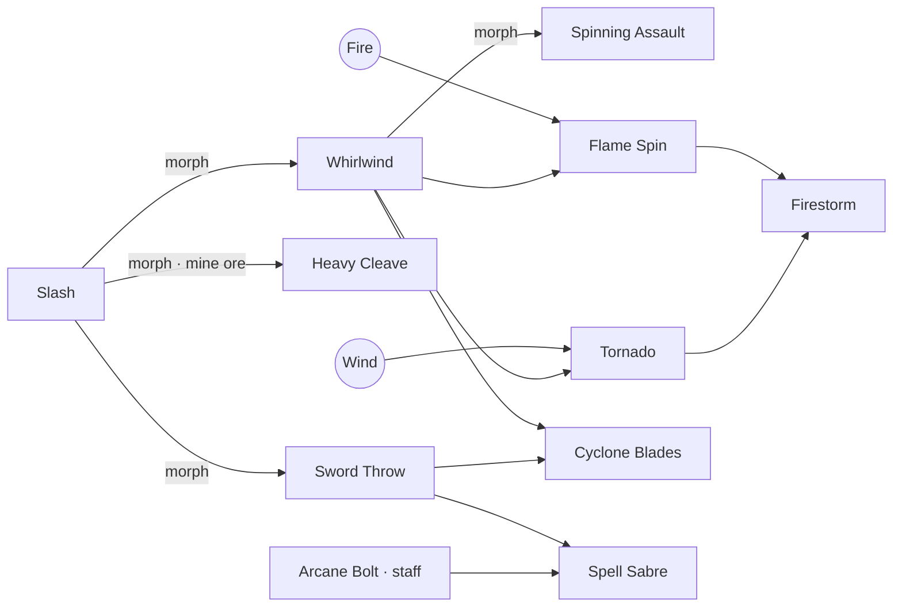

# Omnipath — Game Design Document

> A 2D open-world action RPG for mobile, in the spirit of early-2000s MMOs.
> No skill is ever handed to you from a menu. Every technique, element, and class
> is **discovered** by mastering, morphing, and fusing what you already know.

---

## 1. Pillars

1. **Every skill is earned by doing.** Using a skill is the only way to grow it.
2. **Discovery over selection.** No class picker and no skill-point menu. Players experiment the way they would in an alchemy game.
3. **Keep what you had.** Morphing and fusing *add* skills. Nothing is consumed, so experimenting never costs the player a skill.
4. **The world is the tutorial.** Elements hide in ordinary activities like forging, fishing, mining, meditating and hunting.
5. **Every build is a little different.** Two players with the same weapon end up with different grimoires.

---

## 2. Core loop

```
 fight ──► skill gains mastery XP ──► rank up ──► MAX RANK
   ▲                                                 │
   │                                       morph charge earned
   │                                                 ▼
 new skills ◄── FUSION ALTAR ◄── elements ◄── MORPH into a new form
   │             (skill+element,     (found by        (original kept)
   │              skill+skill,        world activities)
   │              element+element)
   ▼
 skill collection matches a hidden pattern ──► CLASS DISCOVERED
```

---

## 3. Skill lifecycle

### 3.1 Starting weapon
The player picks **Sword**, **Dagger**, or **Staff**. Each one grants a single basic attack:

| Weapon | Basic attack | Leans toward |
|---|---|---|
| Sword | Slash | spins, throws, heavy blows |
| Dagger | Quick Stab | stealth, knives, crits |
| Staff | Arcane Bolt | orbs, novas, elemental spells |

Other weapons can be bought from the smith later. Equipping one teaches its basic attack, which opens up **cross-weapon fusions** and hybrid classes.

### 3.2 Mastery
- Each use gives **+1 XP**. Each enemy hit gives **+1**, and each kill gives **+3**, capped at 4 hits per use so AoE skills can't be farmed.
- XP to the next rank is `ceil(4 · rank^1.15 · (1 + 0.35 · tier))`. Higher-tier skills master more slowly.
- Each rank adds **+6% power**.
- Basic and tier-1 skills have 10 ranks, tier-2 skills have 8, and tier-3 skills have 5.

### 3.3 Morphing
- Reaching max rank grants **1 morph charge**.
- Using a skill past max fills an **overmastery** bar, and each full bar grants another charge (up to 3 banked).
- Spending a charge teaches one morph and **keeps the original skill**. For example, Slash can morph into Whirlwind or Sword Throw. The player picks one, then has to earn another charge to get the other.
- Some morphs are **hidden** behind world conditions. Until the condition is met, the Grimoire shows only `???` and a hint:
  - *Heavy Cleave*: "Your swing could learn real weight from striking stone." (mine 6 ore)
  - *Shadowstep*: "Only one who has survived many battles…" (25 kills)
  - *Focus*: "Seek a place of meditation high in the hills." (meditate once)
- **Several paths can lead to the same skill.** Stab → Shadowstep, Quickstep + Shadow → Shadowstep, and Meditation → Focus are all valid routes.

### 3.4 Elements
There are **7 primal elements** and **4 fused elements**. A primal element is learned through a world activity:

| Element | How it's discovered (prototype) |
|---|---|
| 🔥 Fire | Forge 3 good pieces with Brann the Smith (timing minigame, costs ore) |
| 💧 Water | Catch 3 fish at Mirror Lake (reaction minigame) |
| ⛰️ Earth | Mine 10 ore at Greystone Quarry |
| 🍃 Wind | Meditate at the Shrine of Winds without being hit |
| ⚡ Lightning | Drop from the Thunderhoof boss (Storm Shard) |
| 🌑 Shadow | Defeat 5 Gloomcaps, then touch the Umbral Obelisk |
| ✨ Holy | Carry 3 elements, then visit Sister Alba |
| ❄️ Ice | Fuse Water + Wind |
| 🌋 Magma | Fuse Fire + Earth |
| ⛈️ Storm | Fuse Wind + Lightning |
| 🌗 Twilight | Fuse Holy + Shadow |

Each element applies a status effect on hit: burn, slow, stun, knockback, shock, bleed, smite (heals you), or freeze. Elements also follow a matchup chart. A strong matchup deals ×1.5, a weak one ×0.6, and the same element deals ×0.5.

### 3.5 Fusion (the alchemy layer)
At the **Fusion Altar**, any two essences can be combined:

| Combination | Example |
|---|---|
| Element + Skill | Fire + Whirlwind → **Flame Spin** |
| Skill + Skill | Whirlwind + Sword Throw → **Cyclone Blades** |
| Element + Element | Water + Wind → **Ice** (new element) |
| Fusion + Fusion | Flame Spin + Tornado → **Firestorm** |
| Cross-weapon | Sword Throw + Arcane Bolt → **Spell Sabre** |

Rules:
- A skill must reach **rank 5** (or its max, if lower) before it can be used as an ingredient.
- **Authored recipes** have unique names, effects and tuning.
- **Procedural infusion**: any *unaligned attack* without an authored recipe can still fuse with any element and becomes e.g. *Blazing Sword Throw* or *Umbral Fan of Knives*. Because of this, every attack × every element is a valid discovery, and the combination space grows multiplicatively with each skill and element added.
- **Every experiment is remembered.** The altar marks pairs as untried, tried with nothing, or already discovered.
- **Failed experiments whisper hints.** A failure can surface a clue about an undiscovered recipe that uses one of the ingredients, for example *"A spinning blade could carry flame."*

### 3.6 Classes (emergent)
A class is a pattern over the player's skill collection. Each skill's tags (`blade`, `spin`, `stealth`, `arcane`, …), plus its element and weapon, count toward class clauses:

| Class | Pattern | Grants |
|---|---|---|
| Blademaster | 4 × `blade` | Blade Aura |
| Tempest Dancer | 3 × `spin` | Eye of the Storm |
| Pyroblade | 2 × `blade`+`fire` | Searing Edge |
| Shadowstalker | 3 × `stealth` | Shade Cloak |
| Spellblade | 2 × `blade` and 2 × `arcane` | Runic Blade |
| Elementalist | skills with 3 distinct elements | Prism Burst |
| Twilight Sage | 1 × `twilight` and 3 × `arcane` | — |
| …16 total | | |

- Classes are discovered **automatically** the moment the pattern matches.
- The player can **wear** any class they have discovered. The active class gives stat and tag-damage bonuses.
- Undiscovered classes show a riddle and a progress meter, so players can hunt for them on purpose.
- Class signature skills can feed back into fusion and further class patterns.

### 3.7 "Skill trees"
There is no fixed tree. Each player's tree is the graph of what they've discovered so far:
- **Mastery edges**: skill → morph.
- **Fusion edges**: (a, b) → result.
- **World edges**: NPC teachers (Meditation from the Hermit), tomes dropped by monsters (Quickstep from Gustlings), boss relics (Static Field from Thunderhoof), and class signatures.

Example of one sword player's graph:



---

## 4. Combat feel (classic MMO nods)

- **Tap to move** with A* pathfinding. **Tap a monster** to walk into range and auto-attack. Auto-attacks train the basic skill.
- **Hotbar** of 6 skills plus a big attack button. Skills auto-target the current or nearest enemy.
- Floating damage numbers, crits, elemental weaknesses, status ticks.
- Base level and EXP from kills. Dying loses 5% of current EXP.
- Passive and aggressive monsters, leashing, respawns, and a roaming field boss with a telegraphed stomp.

---

## 5. Content in this prototype

| Category | Count |
|---|---|
| Authored skills | 58 (plus procedural infusions: every unaligned attack × 11 elements) |
| Morphs | 22 |
| Authored fusion recipes | 29 |
| Elements | 11 (7 primal, 4 fused) |
| Classes | 16 |
| Monsters | 7 + 1 boss |
| Regions | 8 |
| Discovery activities | forge, fishing, mining, meditation, obelisk, priestess, tomes, boss relic |

---

## 6. Architecture

```
src/
  core/        engine-agnostic rules (no Phaser, no DOM)
    types.ts       data model
    registry.ts    content index, procedural infusion, validation
    skillbook.ts   mastery, morphs, fusion, classes, persistence
    combat.ts      damage + element chart
    mastery.ts     tuning curves
  data/        content as plain TypeScript data
  game/        Phaser client (world gen, entities, skill FX, scenes)
  ui/          DOM overlay (HUD, Grimoire, Fusion Altar, dialogs)
tests/         Vitest: content integrity, mastery/morph/fusion/class rules, world reachability
```

`core/` is deliberately free of Phaser and the DOM so the **same rules can run on an authoritative server**.

### Adding content
1. Add a `SkillDef` to `src/data/skills.ts`.
2. Connect it with a `MorphDef` (`morphs.ts`) or a `FusionRecipe` (`recipes.ts`), or grant it from a class, NPC or item.
3. Run `npm test`. The integrity test fails on unknown ids, duplicate recipes, and **orphan skills that can't be reached**.

Tags drive everything else: class discovery, tag-damage bonuses and projectile visuals. Content only needs consistent tags to plug in.

---

## 7. Road to MMO

| Phase | Scope |
|---|---|
| **0 — Prototype (this repo)** | Single-player vertical slice with the full discovery loop and local saves. |
| **1 — Online foundation** | Authoritative server (Colyseus or Nakama) running `core/`. Client sends intents (cast, move, fuse) and the server validates mastery and fusion. Accounts and cloud saves. |
| **2 — Shared world** | Zone instances with other players visible, party play, chat, trading. |
| **3 — Social discovery** | **World Codex**: the first player to discover a recipe is credited server-wide. Cooperative fusion, where two party members each supply an essence. Guild libraries of shared hints. |
| **4 — Depth** | More weapons (bow, fist, shield), more elements, and morph chains 4–5 tiers deep. Class trees with their own skills, plus dungeons, crafting and an economy around tomes and shards. |

### Anti-cheat considerations
- Mastery XP comes from server-confirmed hits, never from client reports.
- Fusion results are resolved on the server. Clients receive only the recipes they have personally discovered, so the full recipe table can't be datamined from the client.
- Procedural infusion IDs (`skill@element`) are deterministic, so the server can validate them without storing extra data.

---

## 8. Mobile

- Built as a PWA (fullscreen manifest, touch-first UI, safe-area insets, no pinch zoom).
- Layout adapts to portrait and landscape. Panels open as bottom sheets.
- The world pauses while a menu is open in single-player. Online play won't pause.
- Ship to the App Store and Google Play by wrapping `dist/` with Capacitor (steps in README).
